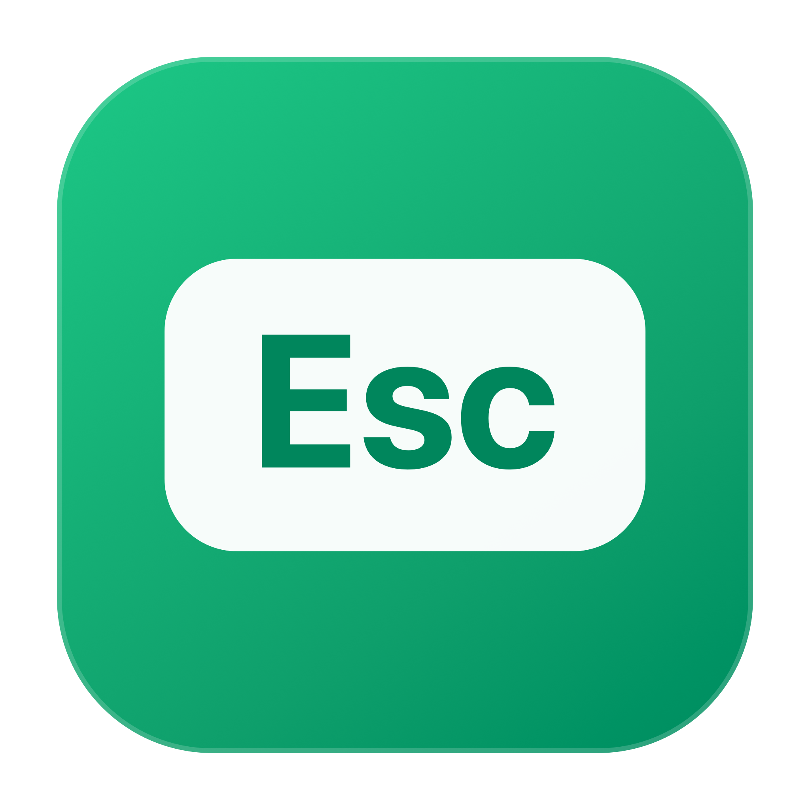

<p align="center">
  
</p>

<h1 align="center">EscClose</h1>

<p align="center">Press <kbd>Esc</kbd> to close the current WeChat window on macOS.</p>

<p align="center">
  
  
  
  
</p>

<p align="center">
  <a href="https://github.com/alchemy7746/esc-close">GitHub</a> ·
  <a href="https://gitee.com/alchemy_star/wx-esc-close">Gitee mirror</a> ·
  <a href="README.md">中文</a> ·
  <a href="CHANGELOG.md">Changelog</a> ·
  <a href="CONTRIBUTING.md">Contributing</a>
</p>

---

EscClose is a small macOS menu bar utility that brings the Windows-style `Esc` behavior to WeChat for Mac.

- Responds to `Esc` only when WeChat is frontmost
- Closes the current WeChat window without quitting the app
- Does not modify or inject code into WeChat
- No network access, telemetry, or chat data collection
- Universal binary for Intel and Apple Silicon

## Install

Download the latest zip from [Releases](../../releases/latest), move `EscClose.app` to Applications, launch it, and grant Accessibility permission.

macOS requires Accessibility access to observe a global key and operate another app's window. EscClose processes only `Esc`; other keyboard events pass through unchanged.

## Build

GitHub:

```bash
git clone https://github.com/alchemy7746/esc-close.git
cd esc-close
make build
open dist/EscClose.app
```

Gitee mirror:

```bash
git clone https://gitee.com/alchemy_star/wx-esc-close.git
cd wx-esc-close
make build
open dist/EscClose.app
```

## How it works

EscClose uses public macOS APIs only:

1. A `CGEventTap` observes the `Esc` key.
2. The frontmost app's bundle ID is checked against `com.tencent.xinWeChat`.
3. The window close button is pressed through the Accessibility API.
4. If WeChat uses custom window chrome, EscClose falls back to `Command-W`.

No private WeChat APIs, code signing bypasses, or dynamic library injection are involved.

## Privacy

EscClose has no network code and collects no data. Diagnostics are written locally to `~/Library/Logs/EscClose.log`. The log contains permission and window-close outcomes, never typed text or chat content.

See [PRIVACY.md](PRIVACY.md) for details.

## Status

Tested with WeChat 4.2.0 on macOS 15.8.1. The project targets macOS 12+ and builds for both x86_64 and arm64. Compatibility reports are welcome.

## License

[MIT](LICENSE)

EscClose is an independent project and is not affiliated with Tencent. WeChat is a trademark of Tencent.
