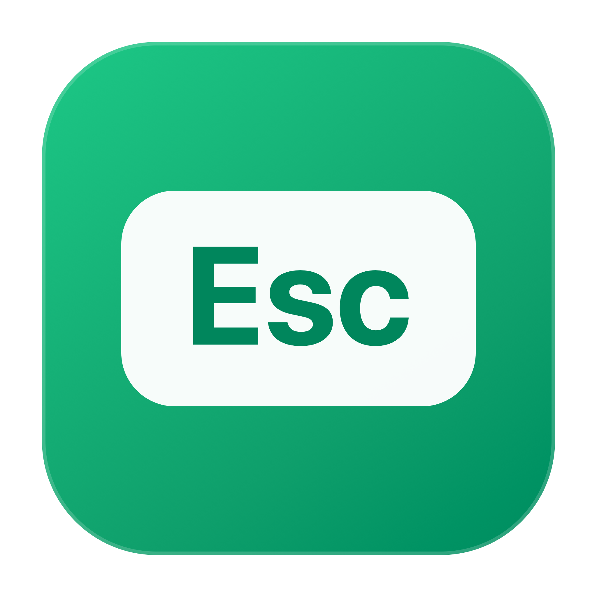

<p align="center">
  
</p>

<h1 align="center">EscClose</h1>

<p align="center">微信在前台时，按 <kbd>Esc</kbd> 关闭当前窗口。</p>

<p align="center">
  
  
  
  
</p>

<p align="center">
  <a href="https://github.com/alchemy7746/esc-close">GitHub</a> ·
  <a href="https://gitee.com/alchemy_star/wx-esc-close">Gitee 镜像</a> ·
  <a href="README.en.md">English</a> ·
  <a href="CHANGELOG.md">更新记录</a> ·
  <a href="CONTRIBUTING.md">参与贡献</a>
</p>

---

## 为什么做这个

Windows 版微信里，按 `Esc` 关闭当前窗口是很自然的操作。macOS 版没有这个行为，切回微信后还需要移动鼠标点关闭按钮，或者按 `⌘ W`。

EscClose 用一个小巧的菜单栏 App 补上这个习惯：

- 只在微信位于前台时响应 `Esc`
- 关闭微信当前窗口，但不退出微信
- 不修改微信本体，不注入进程，不读取聊天内容
- 不联网，不收集任何数据
- Intel 与 Apple Silicon 通用

## 安装

### 使用 Release

1. 从 [Releases](../../releases/latest) 下载最新的 `EscClose-*.zip`。
2. 解压并把 `EscClose.app` 拖到「应用程序」。
3. 打开 EscClose，按系统提示授予「辅助功能」权限。
4. 切换到微信，按 `Esc`。

> macOS 要求辅助功能权限，才能监听全局按键并操作其他 App 的窗口。EscClose 只处理 `Esc`，其他按键会原样传递。

### 从源码构建

环境要求：

- macOS 12 或更高版本
- Xcode Command Line Tools
- 不需要第三方依赖

GitHub：

```bash
git clone https://github.com/alchemy7746/esc-close.git
cd esc-close
make build
open dist/EscClose.app
```

Gitee 镜像：

```bash
git clone https://gitee.com/alchemy_star/wx-esc-close.git
cd wx-esc-close
make build
open dist/EscClose.app
```

构建产物位于 `dist/`：

- `EscClose.app`
- `EscClose-1.1.0.zip`

## 使用

微信在前台时按 `Esc`，当前窗口会关闭，微信继续在后台运行。

点击菜单栏的 `Esc` 图标可以：

- 暂停或启用功能
- 测试关闭微信窗口
- 重新检测权限
- 打开诊断日志
- 退出 EscClose

## 工作方式

EscClose 使用 macOS 公开的辅助功能 API，不依赖微信私有接口：

1. `CGEventTap` 在系统事件层捕获 `Esc`。
2. 检查当前前台 App 的 bundle ID 是否为 `com.tencent.xinWeChat`。
3. 通过 Accessibility API 按下微信窗口的关闭按钮。
4. 如果微信使用了自定义窗口控件，则回退到标准 `⌘ W`。
5. 对重复事件做防抖处理，避免两个监听到同一按键时重复执行。

这种实现比向微信注入动态库更稳定，也不受微信版本内部结构影响。

## 兼容性

| 项目 | 状态 |
| --- | --- |
| macOS 15.x | 已测试 |
| macOS 12–14 | 代码支持，尚未完整测试 |
| 微信 4.2.0 | 已测试 |
| 微信 3.x | 理论支持，尚未验证 |
| Intel Mac | 已构建验证 |
| Apple Silicon | 已构建，等待更多设备验证 |

如果你在其他版本上测试成功或失败，欢迎提交 Issue，帮助完善兼容性表。

## 隐私

EscClose：

- 不包含网络请求
- 不包含遥测、统计或崩溃上报
- 不读取、不存储聊天内容
- 只记录启动、权限、`Esc` 捕获结果和窗口关闭结果
- 日志仅保存在本机：`~/Library/Logs/EscClose.log`
- 日志达到约 512 KB 后自动清空

详见 [PRIVACY.md](PRIVACY.md)。

## 常见问题

### 按 Esc 没反应

打开「系统设置 → 隐私与安全性 → 辅助功能」，确认 `EscClose` 已开启。重建或移动 App 后，macOS 可能要求重新授权。

### 菜单显示“按键监听未启动”

先点「重新检测权限」。如果仍无效，从菜单打开诊断日志，并把相关日志贴到 Issue 中。

### 更新后需要重新授权

这是 macOS 对未签名或临时签名 App 的常见行为。正式发布建议使用 Developer ID 签名并公证，详见 [RELEASING.md](RELEASING.md)。

## 与现有方案的区别

这类功能可以用 [Hammerspoon](https://github.com/Hammerspoon/hammerspoon)、[Karabiner-Elements](https://github.com/pqrs-org/Karabiner-Elements) 或 BetterTouchTool 配置出来，但它们都是通用自动化工具，需要用户自己写脚本或维护复杂配置。

EscClose 的目标是：

- 安装后即可使用
- 不修改微信
- 无网络依赖
- 交互足够简单
- 源码足够小，方便审计和二次开发

[WeChatTweak](https://github.com/sunnyyoung/WeChatTweak) 等项目的方向不同，它们会修改或注入微信，功能更多，但也更容易受微信版本更新影响。

## 镜像

- GitHub：<https://github.com/alchemy7746/esc-close>
- Gitee：<https://gitee.com/alchemy_star/wx-esc-close>

GitHub 是主仓库，GitHub Actions 自动构建 Release；Gitee 是同步镜像。同步方法见 [MIRRORS.md](MIRRORS.md)。

## Roadmap

- [ ] 可配置目标 App 列表
- [ ] 可配置按键
- [ ] 关闭窗口 / 隐藏 App 两种模式
- [ ] 英文界面
- [ ] Homebrew Cask
- [ ] 签名与公证的正式 Release

## 参与贡献

欢迎提交 Issue 和 Pull Request。请先阅读 [CONTRIBUTING.md](CONTRIBUTING.md)。

## 免责声明

EscClose 是独立开源项目，与腾讯及微信官方无关。微信是腾讯公司的商标。

## License

[MIT](LICENSE)
